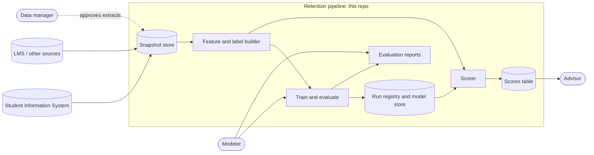
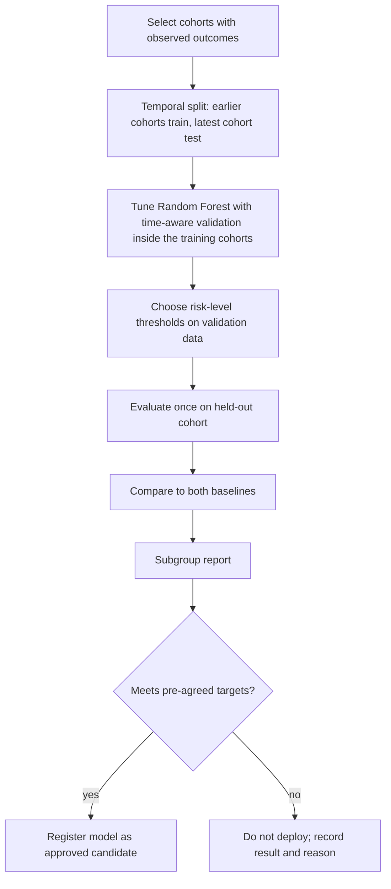
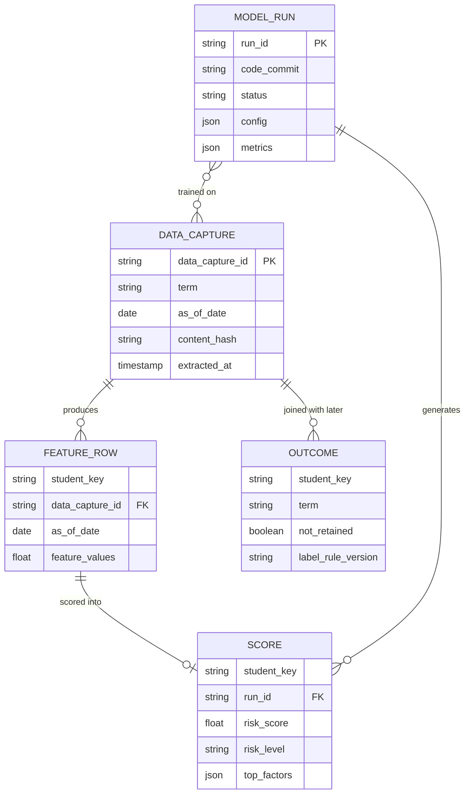

# Design

## 1. Context

The system is a  pipeline. At each scheduled as-of date it takes a dated copy of student records, builds features and (for past cohorts) labels, trains or loads a Random Forest, and writes a table of risk scores for advisors.

| Component | Responsibility | Status |
| --- | --- | --- |
| Data captures | Dated, immutable copies of source data, keyed by `(term, as_of_date)` | Planned |
| Feature and label builder | Build features from a data capture, enforcing the as-of cutoff; build labels from observed re-enrollment | Planned |
| Train and evaluate | Temporal split, Random Forest training, baselines, metrics, subgroup report | Planned |
| Run registry and model store | Record every run with commit, data captures, config, metrics; store model artifacts | Planned |
| Batch scorer | Score a cohort at an as-of date, assign risk levels, compute explanations | Planned |
| Scores table | Output consumed by advisors | Planned |

## 2. Key Flows

### 2.1 Training and evaluation (per term, run by a modeler)

The held-out cohort is evaluated once. Tuning on it invalidates the result.

## 3. Decisions Made and Deferred

### Decided (proposed, pending team confirmation)

| Decision | Reason |
| --- | --- |
| Model family is Random Forest for this phase | Team decision at kickoff; handles mixed feature types and gives global importances |
| Label is observed re-enrollment at the next census date | A constructed label (survey rules, grade thresholds) measures our rule, not student departures |
| Predictions are made at a fixed as-of date; features may not use later data | Prevents leakage and matches how advisors would use the score |
| Data captures are immutable and captured from day one | History cannot be reconstructed after the source system overwrites it |
| Pipeline is batch, scheduled | Outcomes resolve once per term, so intra-day freshness has no demonstrated value |
| Evaluation uses a temporal split, never a random split | A random split lets the model see future cohorts |
| Per-student explanations must account for the direction of each factor's effect | A simple "importance × encoded value" heuristic can rank a protective factor as a risk driver |
| Synthetic fixtures only in the repo | Real student data must not live in the repository |

### Deferred on purpose

| Decision | Why deferred | Decide by |
| --- | --- | --- |
| Hosting environment (institution-controlled vs. other) | Depends on IT capacity, data governance, and open question 7 | Before first real data intake |
| Explanation method (e.g., TreeSHAP vs. permutation-based) | Needs a library license check and a test on real feature types | Before FR-10 is implemented |
| Probability calibration method (e.g., isotonic, Platt) | Needs real outcome data and enough samples to calibrate | After first temporal evaluation |
| Dashboard or UI technology | Output table and static reports suffice for this phase | After a pilot shows advisors want one |
| Scheduler and orchestration tool | Any batch scheduler works; choice follows hosting | With hosting decision |
| Retraining cadence | Should follow observed drift, not a guess | After two terms of monitoring |
| Whether demographic attributes are model inputs | Legal and fairness review required | Before feature list is frozen |

## 4. Interfaces and Contracts

### 4.1 Data capture contract

One directory or table partition per `(term, as_of_date)`.

| Field | Type | Notes |
| --- | --- | --- |
| `data_capture_id` | string | Deterministic, e.g. `{term}_{as_of_date}` |
| `source` | string | System of origin |
| `extracted_at` | timestamp | When the extract ran |
| `content_hash` | string | Hash of the stored data |
| `record_timestamps` | per-table | Every record carries the time it was true in the source |

Rule: once written, a data capture is never modified. Corrections are new data captures.

### 4.2 Feature table contract

| Column | Type | Notes |
| --- | --- | --- |
| `student_key` | string | Pseudonymous token, never a raw ID |
| `as_of_date` | date | Prediction date |
| `data_capture_id` | string | Source data capture |
| `<feature_n>` | numeric/categorical | Each feature declares `source_table` and `source_timestamp_column` in a feature registry file |

### 4.3 Scores output contract

| Column | Type | Notes |
| --- | --- | --- |
| `student_key` | string | Pseudonymous token |
| `as_of_date` | date | |
| `model_version` | string | Registry ID |
| `data_capture_id` | string | |
| `risk_score` | float [0,1] | Labeled uncalibrated unless a calibration step is validated |
| `risk_level` | enum | High / Medium / Low, from config thresholds |
| `top_factors` | list | Up to 3 factors with signed direction |
| `generated_at` | timestamp | |

The mapping from `student_key` back to a real student lives outside this repo, with the data steward.

### 4.4 Proposed command-line interface

| Command | Purpose |
| --- | --- |
| `retention intake --term T --as-of D` | Create a data capture |
| `retention build-features --data capture ID` | Produce the feature table |
| `retention train --config path` | Train, evaluate, write report, register run |
| `retention score --data capture ID --model VERSION` | Write the scores table |
| `retention verify --run ID` | Rebuild a registered run and compare metrics |

Names are placeholders to be settled when the first command is implemented.

### 4.5 Run registry record

| Field | Notes |
| --- | --- |
| `run_id` | |
| `type` | train / score |
| `code_commit` | Git SHA |
| `data_capture_ids` | All inputs |
| `config` | Full config, including seeds and thresholds |
| `hyperparameters` | |
| `metrics` | With confidence intervals |
| `status` | candidate / approved / retired |
| `approved_by`, `approved_at` | Required to move to `approved` |

## 5. Data Model

Notes:

- `OUTCOME` is created only after the next census date and is never available to feature building for the same as-of date.
- `label_rule_version` ties each label to the written edge-case rules, so changing a rule is visible and does not silently rewrite history.

## 6. Deployment Shape

- **Form:** scheduled batch jobs. No always-on service in this phase.
- **Environment:** `[to be decided: see Deferred]`. Whatever is chosen must keep identifiable data inside a boundary the institution approves, and must support the audit log (FR-13) and access control (NFR-3).
- **Storage:** data capture store, run registry, and scores table need access control and a deletion schedule (NFR-7).
- **Local development:** runs entirely on synthetic fixtures, no network access to real data required.
- **Rollback:** scoring uses a named model version, so rollback means pointing the scorer at the previous approved version. Data captures are immutable and need no rollback.

## 7. Open Technical Questions

1. Are as-of dates fixed per term (one) or several (e.g., weeks 3, 6, 9)? Several multiplies data capture volume and changes how cohorts are split.
2. Is one model trained per as-of date, or one model with `weeks_into_term` as a feature?
3. How are students who first appear mid-term (late enrollees, transfers) handled at an as-of date?
4. How are missing values represented in feature tables, and does the Random Forest implementation chosen handle them natively?
5. How is class imbalance handled (class weights, sampling), and is it tuned only on validation data?
6. What is the minimum number of past cohorts needed for a meaningful temporal test, and what do we do if we have fewer?
7. How are pseudonymization keys managed and rotated, and who holds them?
8. Which features are available at the as-of date in practice, as opposed to appearing in the source system only later (for example, grades posted after the date)?
9. Can the explanation method run fast enough for a full cohort within NFR-4?
